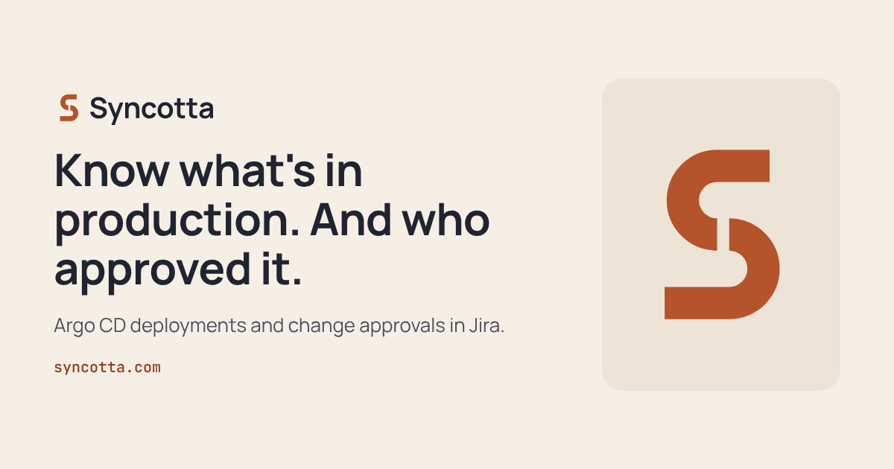
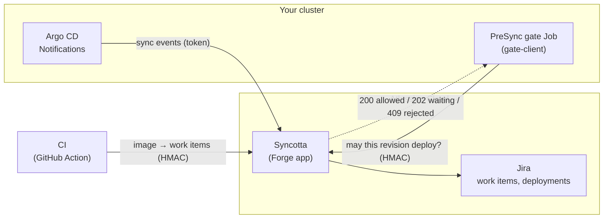

<p align="center">
  
</p>

<p align="center">
  <a href="https://syncotta.com">Website</a> ·
  <a href="https://syncotta.com/docs/getting-started/">Getting started</a> ·
  <a href="https://syncotta.com/docs/">Docs</a> ·
  <a href="https://syncotta.com/security/">Security</a> ·
  <a href="mailto:contact@syncotta.com">Contact</a>
</p>

**Syncotta for Jira** brings Argo CD into Jira Cloud. Every sync shows up on the Jira work items it ships, and
production syncs can wait until someone approves the change in Jira. It is an Atlassian Forge app: it runs on
Atlassian's cloud, and your cluster only sends data out.

> **Alpha.** Deployments in Jira, CI correlation and the change gate on a Jira work item work today. Native Jira
> Service Management Premium change requests come after the alpha. The Atlassian Marketplace listing is on its way.

## What it does

- **Deployments on work items.** Argo CD syncs appear in Jira's Development panel and Releases view: environment,
  status, version, time. Issue keys come from commit messages, a `syncotta.com/issues` annotation, or CI.
- **Images linked by CI.** A small GitHub Action reports which work items an image contains, so multi-source apps
  and image bumps land on the right work items too.
- **A change gate before production.** An Argo CD PreSync hook asks Syncotta before the sync. Syncotta opens a Jira
  work item for the deployment; the sync waits until it reaches an allowing status (for example Done) and stops on a
  rejecting one.

## How it works



Nothing connects into your cluster, Git provider or Argo CD. Every request is authenticated (bearer token or
HMAC signature with replay protection), and secrets live in Forge secret storage.

## What the gate looks like

The PreSync Job's log while a production sync waits for approval in Jira:

```text
10:24:02 gate: asking for payments at revision 2.4.1 (deadline 1800s)
10:24:04 attempt 1: HTTP 202 awaiting approval
10:24:24 attempt 2: HTTP 202 awaiting approval
10:24:47 attempt 3: HTTP 200 allowed, sync continues
```

## Quick start

```bash
# 1. Notifications: once per Argo CD instance (values from the Syncotta admin page in Jira)
helm install syncotta oci://ghcr.io/syncotta/charts/syncotta --version 0.1.0 \
  -n syncotta --create-namespace \
  --set instanceId=<instance id> --set eventsUrl=<events url>

# 2. Report an application
kubectl label application <app> -n argocd syncotta.com/payload=default
```

```yaml
# 3. Optional: link images to work items from CI
- uses: Syncotta/syncotta-action@v0
  with:
    events-url: ${{ secrets.SYNCOTTA_EVENTS_URL }}
    instance-id: ${{ vars.SYNCOTTA_INSTANCE_ID }}
    hmac-key: ${{ secrets.SYNCOTTA_HMAC_KEY }}
    image: ghcr.io/acme/payments:${{ github.sha }}@${{ steps.push.outputs.digest }}
```

The full guide, including the PreSync gate, is at [syncotta.com/docs](https://syncotta.com/docs/).

## Public pieces

| What | Where |
| --- | --- |
| Helm chart (notifications and PreSync gate) | `oci://ghcr.io/syncotta/charts/syncotta` |
| Gate client image (Alpine, curl, openssl; amd64 and arm64) | [`ghcr.io/syncotta/gate-client`](https://github.com/orgs/Syncotta/packages/container/package/gate-client) |
| GitHub Action | [Syncotta/syncotta-action](https://github.com/Syncotta/syncotta-action) |
| Docs | [syncotta.com/docs](https://syncotta.com/docs/) |

## Contact

Questions, early access or feedback: [contact@syncotta.com](mailto:contact@syncotta.com).

<sub>Jira and Jira Service Management are trademarks of Atlassian. Argo CD is a trademark of The Linux Foundation.
Syncotta is not affiliated with or endorsed by either.</sub>
